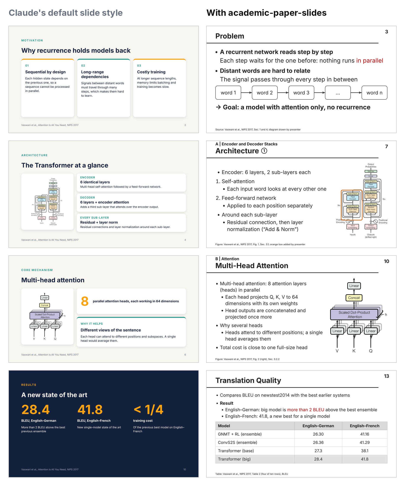

# Academic Paper Slides

A Claude skill for when you need to turn your paper into presentation slides, without the AI-slop look. The deck looks like a person made it: clean, easy to read and easy to edit. You get it as a Claude Slides deck, an editable PowerPoint file or Google Slides, with a script you can read aloud.

**[Download the skill (zip)](https://github.com/ForgerWise/academic-paper-slides/releases/latest/download/academic-paper-slides.zip)** and upload it to Claude as a custom skill. Then attach a paper and ask: *"Make slides for a 15-minute presentation of this paper."*

## See the difference



The same paper, *Attention Is All You Need*, turned into slides by Claude twice. Left: Claude's default slide style. Right: with this skill. Both full decks, including the speaker notes, are in [`examples/attention`](examples/attention).

## Why use it

**No AI-slop look.** No grids of rounded cards, no colored blocks around every sentence, no decorative icons, no accent slides. Pages are white with near-black text and one accent color. Boxes appear only where they mean something: in a diagram, a flow or a formula.

**Every slide shows something.** A short text at the top and, under or beside it, a visual that explains it: the paper's figure with the part under discussion ringed, a table with the key row marked, a formula with its terms boxed and named, or a small diagram drawn from boxes, arrows and line icons that carries one worked example. The skill counts text-only slides and fails a deck that is mostly bullets.

**It reads like a deck a careful person would make.** The slides follow one line of reasoning, from the background and the problem through the method to the results, and each slide picks up where the last one stopped. One message per slide. Titles name the topic in a few words ("Problem", "Positional Encoding", "Training Cost"), and the slides of each part of the method carry that part's name above the title. Bullets have two levels that mean something: the point, then its detail; steps in order are numbered. Text sits beside or above the figure it explains, and every slide names its source.

**It is easy to read from the back of the room.** Text is set as large as the slide allows, 36 to 60px, and figures as large as they stay sharp. A script measures every slide and tells Claude the exact size that fits, so a short text block never floats in an empty column and nothing overflows.

**It is easy to edit afterwards.** A slide is plain text and a visual, not a layout of nested boxes, so you can retitle, reword or cut a line in Claude Slides, PowerPoint or Google Slides without breaking the page. Diagrams are real boxes, arrows and text, not pictures, also in the PowerPoint file. The whole look is a handful of variables in one stylesheet.

**The speaker notes are a script, not a summary.** Full sentences in plain words with an adult tone, written so that a listener who is not looking at the screen still follows. They add what the slide does not say (how to read the figure, why the authors did it this way) instead of reading the bullets back. Each slide's notes start with the time you should reach it.

**It stays faithful to the paper.** Every number, figure number and section number on a slide is checked against the paper, and result slides report results without editorial judgement.

## What you get

- **Your choice of output**: a Claude Slides deck, an editable PowerPoint (.pptx) file, or Google Slides. The PowerPoint file is real slides, not pictures: bullets are text boxes, tables are tables, and the script is in the speaker notes.
- Default structure: cover, background, problem, preliminaries, related work, method overview, method details, experiment setup, results, conclusion. About one slide per minute of talk.
- Diagrams drawn on the slide from boxes, arrows and 22 bundled line icons; the paper's figures explained part by part with the part ringed; formulas with named terms; tables with grid lines and one highlighted row; red emphasis kept to the key terms and numbers.
- Your template if you have one: set the accent color, font and logo. Without one, a neutral black-and-white theme.
- Any deck language. The notes can be in a different language from the slides.

This is one opinionated style for research talks, not the only good one. If your group prefers assertion-style titles, fork it and change the rules in `SKILL.md`.

## Install

- **Claude apps:** download [academic-paper-slides.zip](https://github.com/ForgerWise/academic-paper-slides/releases/latest/download/academic-paper-slides.zip) and upload it as a custom skill. If you install only `SKILL.md`, the skill clones this repository at run time to get its stylesheet, patterns and scripts.
- **Claude Code:** unzip it into `~/.claude/skills/` (or a project's `.claude/skills/`), or load this repository as a plugin.

Tell Claude the talk length, the language, the output you want (Claude Slides, PowerPoint or Google Slides), and your template or brand color if you have one.

## How it works

Rules alone do not hold: a model drifts back to cards and cautious font sizes. So the skill ships three small scripts. `check_layout.js` measures every slide, prints the font size that fills it, and flags a line that wraps for one last word, boxes that overlap and decks with too few visuals. `check_notes.py` rejects notes that cannot be spoken as written and prints the timing. `export_pptx.js` writes the PowerPoint file. They run locally, without the network.

## Requirements

- Claude with the Slides artifact type for a Claude Slides deck. For PowerPoint or Google Slides output, any Claude tool that can write files and run scripts.
- For the scripts: Node.js with Playwright and its Chromium, `pptxgenjs` for the export, and Python 3. Claude's own workspace usually has all of them.
- `pdftoppm` (poppler) to extract figures from the paper.

## Repository layout

```
.claude-plugin/plugin.json          plugin manifest
skills/academic-paper-slides/
  SKILL.md                          the rules and the workflow
  assets/deck.css                   stylesheet; theme = the variables at the top
  assets/icons/                     22 line icons for diagrams
  references/patterns.md            HTML for every slide kind
  scripts/check_layout.js           fill, fit, overflow and line-break check
  scripts/check_notes.py            read-aloud lint and timing
  scripts/export_pptx.js            editable PowerPoint export
examples/attention/                 the paper above as two decks: with the skill, and Claude's default style
docs/compare.png                    the comparison image
```

Try the scripts on the example deck:

```bash
node skills/academic-paper-slides/scripts/check_layout.js examples/attention/with-skill --shots /tmp/shots
python3 skills/academic-paper-slides/scripts/check_notes.py examples/attention/with-skill --minutes 15
node skills/academic-paper-slides/scripts/export_pptx.js examples/attention/with-skill /tmp/attention.pptx
```

## Theming

Edit the variables at the top of `assets/deck.css`: `--ink` (text), `--accent` (title, rule, page number, box outlines, goal line), `--line` (arrows), `--hl` (highlighted table row), `--head` (table header), `--mark` (annotations on figures) and `--em` (red emphasis). A logo and a different font are described at the end of `references/patterns.md`.

## Limits

- 16:9 decks only.
- The scripts measure with the fonts on the machine they run on. If the deck's font is missing where the file is opened, line breaks can shift, so a final look at the result is part of the workflow.
- Google Slides output goes through the PowerPoint file; Google's own conversion decides the last details.
- The notes check catches mechanics (labels, symbols, abbreviations, timing). Whether a script is clear to a listener is still judged by reading it.

## License

MIT. See `LICENSE`.
